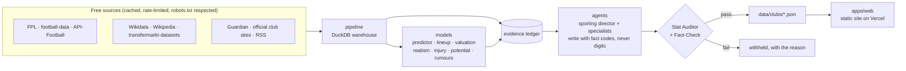

# dugout

**An open-source AI sporting director.** Pick a club in one of six European leagues and dugout writes the report
a sporting director would want: how the side plays, where the squad is thin, who to sign (with a fair price and how
likely the move is), the likely XI, the news that matters and a forecast for the next match.

One hard rule makes it different: **the AI never writes a number.** Every figure comes from an evidence ledger,
is re-run against its source and cross-checked before anything is published. On the site, every number opens a card
that says where it came from, when it was fetched and how it was checked.

[](docs/agents.md)
[](https://github.com/delta96040/dugout/actions/workflows/ci.yml)
[](https://github.com/delta96040/dugout/actions/workflows/nightly.yml)
[](LICENSE)

**[Open the live site →](https://dugout2.vercel.app)** &nbsp;·&nbsp; [How it works](docs/agents.md) &nbsp;·&nbsp;
[Model evidence](docs/backtests/README.md) &nbsp;·&nbsp; [Data sources](docs/sources.md)

[](https://dugout2.vercel.app)

## What you get for every club

| Chapter | What it tells you |
|---|---|
| **Read the club** | League position, form, the manager's style (pressing, threat, chances created) against the rest of the league |
| **Find the gap** | The two biggest squad needs, each with its reason: depth against what a squad carries, the best option's value against similar squads, ageing |
| **Scout the fix** | Three shortlists per need: *dream* targets (best available, whatever the cost), *realistic* ones (clubs that sell, moves that happen) and *hidden gems* (young regulars on the rise), each with a fair price, contract length and why he fits |
| **Linked in the press** | Transfer rumours, attributed, with **how often reports like it came true** (25 years of the Guardian's Rumour Mill, checked against what happened) |
| **The next match** | Win, draw and loss chances, expected goals, the predicted XI and injury news from official sources |
| **Check every number** | Hover any figure: source, fetch time, verification status |

Every prediction is logged before kick-off and scored afterwards on the public [scoreboard](https://dugout2.vercel.app/scoreboard/), right or wrong.

## How it works



1. **Pipeline:** adapters pull free data into a DuckDB warehouse, every request cached and rate-limited. Leagues
   are config (`config/leagues.yaml`), not code.
2. **Models:** each one is backtested on seasons it never saw, against an honest baseline, with negatives reported
   ([docs/backtests](docs/backtests/README.md)). The match predictor beats Elo on every scoring rule; the predicted XI
   matches about 78% of real line-ups; fair fees use buyer and seller context.
3. **Agents:** a sporting director and six specialists see facts as codes (`[F3]`), never values. Code swaps
   each code for its verified figure.
4. **Verification:** the Stat Auditor re-runs every number's query and cross-checks it against a second source;
   Fact-Check (open NLI models) needs an official source or two independent outlets for every claim. Anything that
   fails is withheld and the site says why.
5. **Nightly:** a GitHub Actions job ingests, refits, rebuilds every dossier and re-checks everything, then commits
   the JSON; Vercel deploys it. With warm caches it takes about half an hour.

The writing is done by open-weight models on free tiers (Qwen and gpt-oss on Groq, then OpenRouter, then a local
Ollama model), and by deterministic templates when no draft passes the checks. Numbers are never affected either way.

## Quick start

See the site with the committed data (no keys needed):

```bash
git clone https://github.com/delta96040/dugout && cd dugout
npm --prefix apps/web ci
npm --prefix apps/web run dev        # http://localhost:3000
```

Run the pipeline yourself (Python 3.12, [uv](https://docs.astral.sh/uv/)). Every API key is free:

```bash
cp .env.example .env                 # add your keys
uv sync && uv run dugout ingest      # then: uv run dugout status
uv run dugout-models publish && uv run dugout-agents --no-llm dossier liverpool
```

`make` targets mirror these on macOS and Linux. Add your club's official news with `uv run dugout setup-club <club>`.

## Honest limitations

- **Bookmakers are still better** than the match predictor. It beats Elo in both test seasons
  ([report](docs/backtests/predictor.md)), but closing odds win.
- **The Premier League is the richest.** The five other leagues have results, squads, valuations and shortlists,
  but no injury feed or official club news yet, and their dossiers are template-written.
- **Wages are not shown:** no free source we may use publishes them.
- **Free data has gaps:** API-Football's free plan covers a rolling window, confirmed line-ups arrive shortly before
  kick-off, and Transfermarkt values are refreshed by hand (never scraped from CI).
- **Some models are weak and say so:** injury risk is shown as tiers, and FootballBERT was not adopted because its
  apparent signal was leakage ([all backtests](docs/backtests/README.md)).

## Contributing

Issues and pull requests are welcome; see [CONTRIBUTING.md](CONTRIBUTING.md). Good first issues are labelled.

## Data credits

StatsBomb Open Data · Wyscout public dataset (Pappalardo et al., 2019, *Scientific Data* 6:236) · SkillCorner Open Data ·
Metrica Sports sample data · PFF FC World Cup 2022 · Reep Register (CC0) · transfermarkt-datasets (CC0) ·
Wikipedia transfer lists (CC BY-SA 4.0) · ECB reference rates · football-data.co.uk · football-data.org · API-Football ·
Fantasy Premier League · ClubElo · Open-Meteo (CC-BY 4.0) · Wikidata (CC0) · postcodes.io (OGL) ·
The Guardian Open Platform · official club websites (press credited to the original outlet).
Every source and its terms: [docs/sources.md](docs/sources.md).

## Licence

MIT. Data stays under its providers' terms; raw scraped data is never committed or redistributed.
