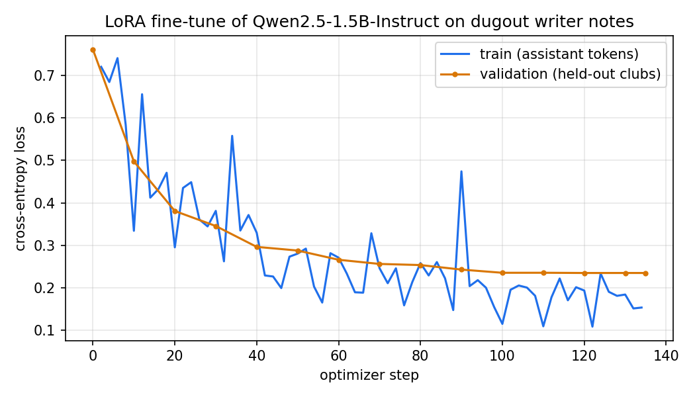

# Fine-tuned writer: a 1.5B model that writes dossier notes which pass the publish gate

## Résumé summary

**Problem.** dugout's writer turns fact cards into short briefing notes. The LLM never writes a number: values are
fact codes (`[F3]`) that code swaps for audited ledger values. A note is published only if it passes the full gate
(Stat Auditor: no stray numbers, every value re-run against its source; binding: each value sits in a sentence
that names its subject and metric; NLI Fact-Check of every sentence). The hosted writer (Qwen3.8-27B on Groq's free
tier) is capped at 200k tokens a day; the local fallback (Qwen2.5-3B on CPU) passes the gate for under half the
notes.

**Data.** 745 gate-passing notes (705 train, 40 validation) built with `dugout-agents finetune-data` from
production prompts across 102 clubs in six leagues; 12 clubs (two per league) held out entirely for testing.
Teacher: Qwen3.8-27B, served on Kaggle's free T4s with llama.cpp (the hosted free tier was too small: see below),
two samples per prompt, judged locally by the same checks as production (rejection sampling).

**Method.** LoRA (r 16, all attention and MLP projections) on Qwen2.5-1.5B-Instruct, loss on the reply only, three
epochs on one Kaggle T4 (55 min), pinned library versions, seed 7; merged and quantized to a 935 MiB q4_K_M GGUF
for Ollama.

**Results** (12 held-out clubs, 50 notes per writer, dugout's own `bench-writer`):

| Writer | Accepted (95% CI) | First try | Drafts with stray numbers | s / note |
|---|---|---|---|---|
| **dugout-writer-1.5b** (fine-tuned, local CPU) | **96%** (87-99%) | **82%** | **0** | 19.0 |
| Qwen3.8-27B on Groq (teacher, hosted) | 66% (52-78%) | 40% | 1 | 14.0 |
| Qwen2.5-3B (previous local fallback, CPU) | 44% (31-58%) | 20% | 10 | 62.5 |
| Qwen2.5-1.5B (base, local CPU) | 32% (21-46%) | 24% | 24 | 33.2 |

Validation loss 0.761 -> 0.235. The fine-tune is 3x faster than the 3B fallback it replaces in `LLM_CHAIN` and is
published under Apache-2.0: [dhrxvie/dugout-writer-qwen2.5-1.5b](https://huggingface.co/dhrxvie/dugout-writer-qwen2.5-1.5b).
Notebooks: [training](https://www.kaggle.com/code/dhruv9604/dugout-writer-lora-1-5b),
[teacher](https://www.kaggle.com/code/dhruv9604/dugout-writer-teacher).

## The dataset

Built by `uv run dugout-agents finetune-data` (`packages/agents/src/dugout_agents/finetune.py`, tests in
`test_finetune.py`).

- **Prompts.** Exactly what production sends (`writer.SYSTEM`, `writer.USER`, `writer.card`): the five written
  dossier sections (club, match, news, transfer, scout; the lineup is always templated), the sporting director's
  summary, and player questions (season, value, availability, potential, fit), 2,448 in all for train and
  validation clubs. Fact codes start at a stable per-prompt offset so the student sees small and large codes.
- **Split.** By club, a stable hash within each league: 96 train, 6 validation, 12 test clubs (Bayern München,
  Chelsea, Elche, Elversberg, Espanyol, Heerenveen, Internazionale, Manchester City, Monza, Olympique Lyonnais,
  Rennes, Utrecht). No prompt about a test club is ever taught.
- **Targets.** The teacher's raw reply (codes, no numbers); a reply with any digit outside a code is dropped
  (13). A pair is kept only if the reply passes the writer's checks *and* `graph.gate` publishes it whole. A note
  accepted after production's one retry is paired with the first prompt, so the student learns to get it right
  first time. Duplicates (same prompt or same note up to codes) are dropped (none found).
- **Teachers.**

  | Teacher | Prompts | Kept |
  |---|---|---|
  | Qwen3.8-27B, Groq free tier (online, with one retry) | 255 | 81 |
  | gpt-oss-120b, Groq free tier (fallback when Qwen was capped) | 12 | 6 |
  | Qwen3.8-27B Q4_K_M, llama.cpp on Kaggle 2x T4 (two samples, best that passes) | 1,499 | 658 |

  Offline, 482 notes passed on the production-temperature sample (0.2) and 176 more on the second (0.7). The
  Kaggle run took 7.0 h of GPU (2,998 samples, 1.97M prompt and 0.27M completion tokens).
- **Mix (train + val).** transfer 301, potential 189, club 114, scout 77, match 33, director 18, news 11, fit 2;
  premier_league 167, la_liga 135, serie_a 128, bundesliga 110, eredivisie 109, ligue_1 96.
- **Why the teacher failed** (offline, first reason per prompt): a value bound to the wrong subject or contradicted
  (534), a sentence the Fact-Check could not verify (192), a stat that no longer re-runs to its ledger value (61, a
  data issue in the warehouse copy, not the writing), two recommendation sentences (31), numbers written directly
  (26). Club-level team news never passed (0 of 10); player questions on season form passed 17%.
- **Licence.** Teacher outputs: Qwen3.8-27B and gpt-oss-120b are Apache-2.0 open weights; Groq's terms leave
  outputs to the user. The dataset itself is **not** published (git-ignored `data/finetune/`, a private Kaggle
  dataset) because fact cards quote news headlines and rumour text; anyone can rebuild it from the code.

## Training

`tools/finetune/train.py`, pushed as a Kaggle script kernel by `tools/finetune/push.py` (Kaggle CLI 2.2.4 via `uvx`,
credentials from `.env`). transformers 4.56.2, peft 0.17.1, accelerate 1.10.1, torch 2.11 (Kaggle image), llama.cpp
b6550 for the GGUF. fp16 base with fp32 LoRA weights (the T4 has no bf16), batch 1 x 16 accumulation (a batch of 2
ran out of memory on the 151k-token vocabulary's logits), gradient checkpointing, cosine schedule with 5% warmup,
lr 2e-4, three epochs, 135 steps.



Validation loss falls from 0.761 to 0.296 in the first epoch and settles at 0.235; it does not rise in the third
epoch (no sign of over-fitting at this size). Data: [writer_finetune/loss_curve.csv](writer_finetune/loss_curve.csv).

## Evaluation

`uv run dugout-agents bench-writer --clubs heldout --models <m> --name writer_finetune_bench_<m>`, the five written
sections of each held-out club (50 notes), the same gate as production, one retry. bench-writer now feeds the
writer exactly what production does (scout's 60-fact cap; no lineup prose). Local models ran through Ollama 0.40 on
the laptop's CPU, all at q4_K_M with an 8k context (`tools/finetune/ollama_create.py`; the previous fallback ran as
installed). Groq ran with `--patient`: it waited 12.1 h on the free tier's daily token cap, excluded from its
seconds per note. Merged by `tools/finetune/report.py` into `writer_finetune.json` (the site's source).

| Writer | Accepted | First try | Stray-number drafts | Accepted notes copying the card layout | Template sentences | Values per note |
|---|---|---|---|---|---|---|
| dugout-writer-1.5b | 96% | 82% | 0 | 0 | 36% | 5.1 |
| Groq Qwen3.8-27B | 66% | 40% | 1 | 0 | 53% | 6.1 |
| Qwen2.5-3B | 44% | 20% | 10 | 4 | 20% | 6.7 |
| Qwen2.5-1.5B base | 32% | 24% | 24 | 0 | 9% | 3.2 |

*Template sentences*: share of sentences in accepted notes that equal a card's example sentence word for word.
*Values per note*: distinct values cited in an accepted note.

Same section, both accepted (Bayern München, club; placeholders unrendered):

> **Fine-tuned:** Bayern München are {{stat:…|ord}} in the Bundesliga table with {{stat:…}} points. The club has
> scored {{stat:…}} league goals while conceding {{stat:…}} league goals. Vincent Kompany has been Bayern München's
> head coach since {{stat:…|date}}. We recommend continuing the current tactical setup as it has been effective
> under his leadership.
>
> **Teacher:** Bayern München are {{stat:…|ord}} in the Bundesliga table with {{stat:…}} points. The team has scored
> {{stat:…}} league goals while conceding {{stat:…}} league goals. Vincent Kompany has been Bayern München's head
> coach since {{stat:…|date}}. We recommend continuing to support the current tactical setup.

## Reading it honestly

- **The student beats its teacher on this gate, and that is expected.** It only ever saw the teacher's passing
  notes (rejection sampling), so it learned the contract without the misses. It is not just copying the example
  sentences (36% of its sentences, against 53% for the teacher), but its notes cite about one value fewer: it
  plays safer.
- **Small sample.** 50 notes per writer, one seed; the intervals above are wide (the fine-tune's and the teacher's
  do not overlap, the teacher's and the 3B's do).
- **Acceptance means safe, not good.** The gate checks every number and claim, not judgement: the one
  recommendation a note may carry is the model's opinion (one fine-tuned note advises "prioritizing the sale" of a
  player on no stated basis). And four of the 3B's accepted notes copy the fact-card layout ("Facts: - … (code …)")
  and still pass: a gate gap worth closing.
- **Where the gap comes from.** By section (accepted / notes): club 12/12 for both; match 12/12 vs 2/12 (the
  teacher keeps adding a second recommendation); scout 12/12 vs 7/12; transfer 12/12 vs 11/12; news 0/2 vs 1/2.
  The fine-tune's two failures are both team news, which the training data barely has (11 examples).
- **Speeds are a laptop CPU's,** shared with other work; the order (1.5B < 3B) is what matters. Groq is faster per
  note but only for about 80 notes a day.
- **What changed during the work.** The plan was to teach with Groq's Qwen directly. Its free tier allows 200k tokens
  a day for that model (about 80 requests), so the bulk moved to the same Apache-2.0 weights on Kaggle
  (4-bit, so not bit-identical to Groq's serving). An early Groq benchmark that ran into the cap (31 of 50 notes
  errored) was discarded and re-run patiently.
- **Not done.** No 3B fine-tune: Qwen2.5-3B's licence is Qwen Research (non-commercial), not open. No teacher-mix
  ablation (the Groq-era notes are 12% of the data). No human rating of note quality.

## Reproduce

```bash
uv run dugout-agents finetune-data --max-calls 300                 # online teacher (Groq), resumable
uv run dugout-agents finetune-data --export-prompts                # the rest for the offline teacher
uv run python tools/finetune/push.py data --job teach && uv run python tools/finetune/push.py kernel --job teach
uv run python tools/finetune/push.py output --job teach
uv run dugout-agents finetune-data --import-replies data/finetune/kaggle/dugout-writer-teacher/replies.jsonl
uv run python tools/finetune/push.py data --job train && uv run python tools/finetune/push.py kernel --job train
uv run python tools/finetune/push.py output --job train
uv run python tools/finetune/ollama_create.py data/finetune/kaggle/dugout-writer-lora-1-5b/dugout-writer-q4_K_M.gguf
uv run dugout-agents bench-writer --clubs heldout --models local:dugout-writer-1.5b --name writer_finetune_bench_dugout-writer-1-5b
uv run python tools/finetune/report.py && uv run python tools/finetune/publish_hf.py
```
